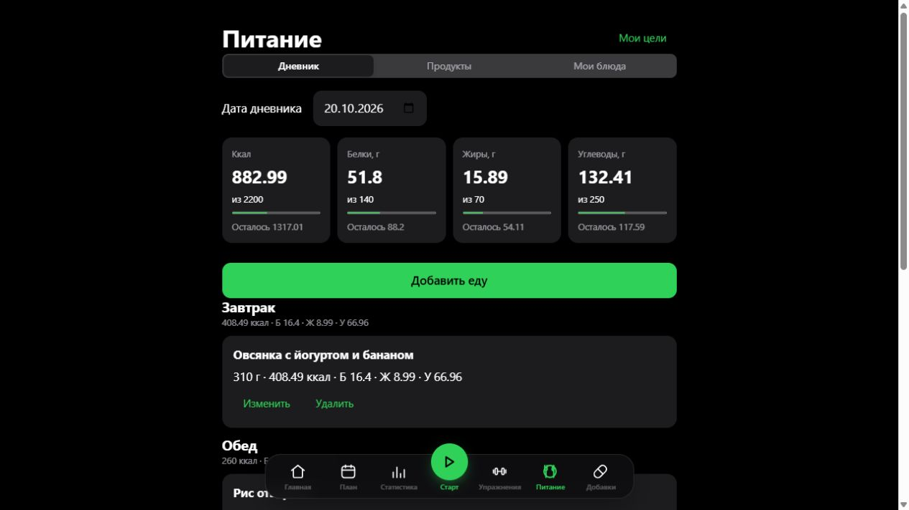
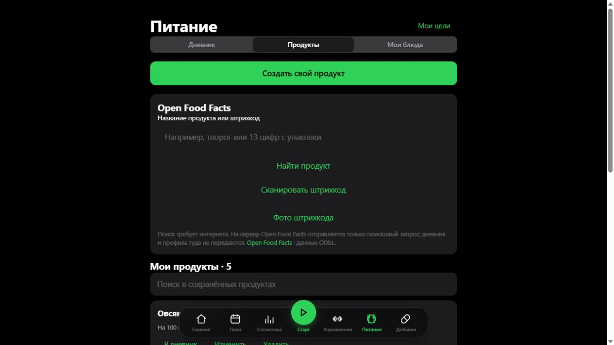
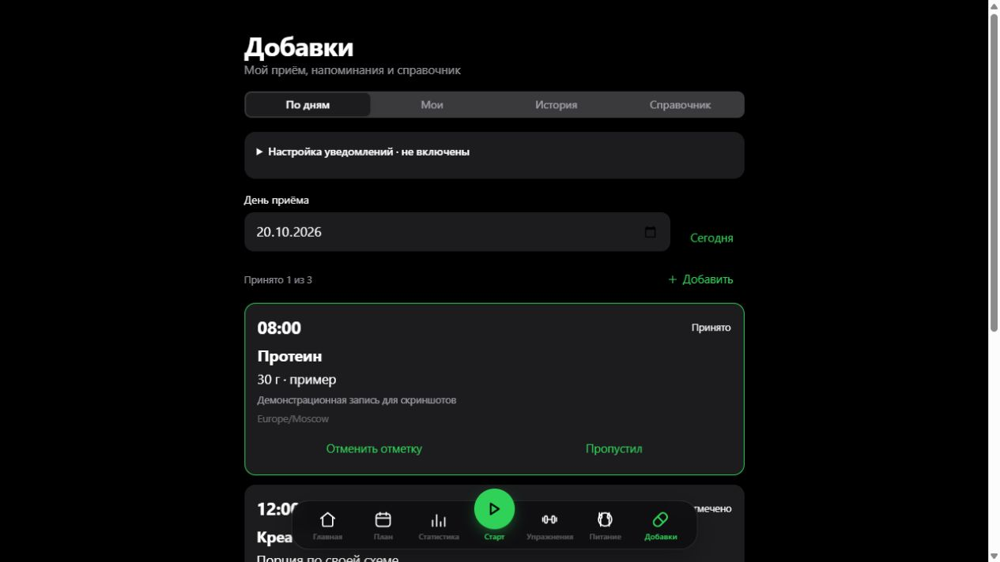
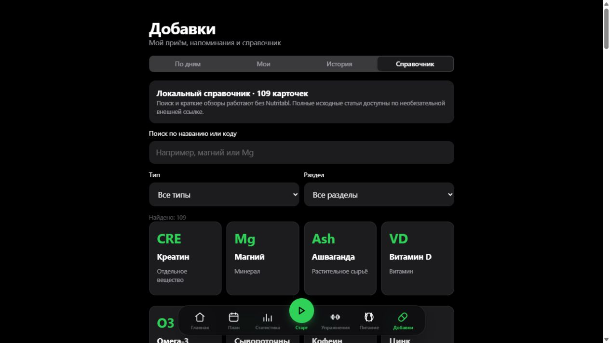
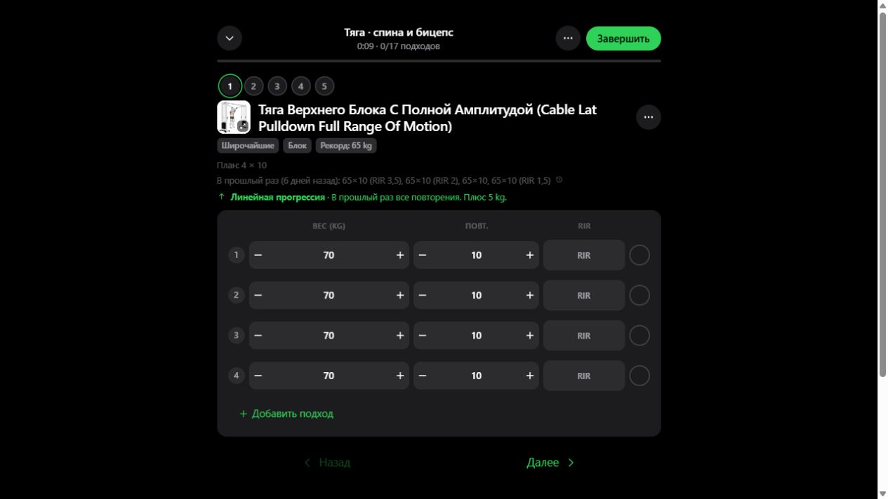
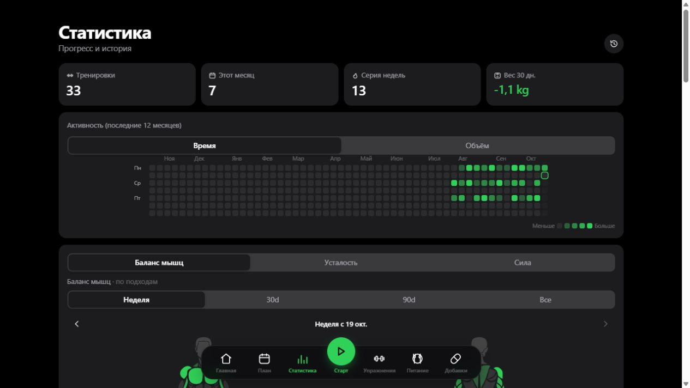

# openGym — тренировки, питание и добавки

Русская версия [openGym](https://github.com/DuarteSantos8/openGym) для своего сервера.
Тренировочный план, история занятий, вес, дневник калорий и БЖУ, приём добавок и
чтение данных через Codex находятся в одном профиле.

Это репозиторий доработанной версии. Публичный сайт, демо, мобильные релизы и
контейнеры исходного проекта не содержат автоматически все описанные здесь изменения.

## Скриншоты

Текущий русский интерфейс. Все записи на снимках демонстрационные, личные данные
пользователей не используются. Нажмите на изображение, чтобы открыть его в полном размере.

| Питание: калории и БЖУ | Open Food Facts и сканер штрихкодов |
|---|---|
| [](assets/screenshots/ru/nutrition.jpg) | [](assets/screenshots/ru/products.jpg) |

| Приём спортивных добавок | Локальный справочник веществ |
|---|---|
| [](assets/screenshots/ru/supplements.jpg) | [](assets/screenshots/ru/catalogue.jpg) |

| Тренировка: веса и подходы | Статистика занятий |
|---|---|
| [](assets/screenshots/ru/workout.jpg) | [](assets/screenshots/ru/stats.jpg) |

## Что есть в приложении

| Раздел | Возможности |
|---|---|
| Главная | План на сегодня, переход к тренировке, запись веса и состояние синхронизации |
| План | Свои программы и упражнения, расписание по дням недели или ротация тренировок |
| Старт | Начало и продолжение занятия: подходы, повторения, рабочие веса, таймер отдыха |
| Статистика | История тренировок, силовые рекорды и расчётный 1RM, нагрузка по мышцам, вес и замеры |
| Упражнения | Поиск по каталогу, фильтры, инструкции и иллюстрации; свои упражнения |
| Питание | Дневник по датам и приёмам пищи, калории и БЖУ, дневные цели, свои продукты и блюда |
| Добавки | Личный график приёма, дозировка, описание, дни и время, напоминания, отметки и история |

Данные зарегистрированного пользователя синхронизируются с его профилем на вашем
сервере. Основной пользовательский интерфейс переведён на русский; часть панели
администратора и дополнительных экранов остаётся на английском.

### Питание и Open Food Facts

- Поиск продуктов по названию или цифрам штрихкода через Open Food Facts.
- Сканирование штрихкода камерой и распознавание штрихкода на выбранной фотографии.
- Сохранение и редактирование найденного продукта в своём каталоге.
- Свои продукты с калориями, белками, жирами и углеводами на 100 г.
- Блюда из ингредиентов: расчёт БЖУ с учётом массы готового блюда.
- Учёт порции продукта или блюда в дневнике и сравнение с заданными целями.

Open Food Facts требует интернета; это внешняя база, а не полная база продуктов
внутри установки. Фото штрихкода обрабатывается в браузере. Сканер читает полосы
штрихкода — произвольный текст и таблицу БЖУ на упаковке он не распознаёт.
Камера требует разрешения браузера и защищённого соединения (HTTPS либо localhost).
Если продукт не найден, его можно создать вручную.

### Добавки и справочник

- Для каждой добавки задаются название, своя доза, заметки, время, дни недели,
  часовой пояс и период приёма.
- Приём отмечается как «Принято» или «Пропущено»; без отметки он остаётся неотмеченным.
- Добавку можно связать с продуктом и массой порции. При отметке «Принято» её
  калории и БЖУ попадают в дневник питания один раз.
- Встроен локальный справочник веществ по материалам Nutritabl: названия, краткие
  обзоры, классификация и ссылки на источники. Это сохранённый справочник,
  а не полная копия сайта и не постоянно обновляемая база статей.

В открытом приложении есть напоминания. Для фоновых системных уведомлений нужно
включить push в разделе «Добавки», разрешить уведомления и использовать браузер/ОС
с поддержкой Web Push. Сервер должен работать; доставка зависит от браузера,
настроек устройства и сети. Приложение хранит вашу схему, но не назначает дозировки.

### Codex / MCP / API

Отдельный MCP-процесс предоставляет 13 инструментов только для чтения: программы,
тренировки, вес, силовые показатели, питание, свои продукты/блюда и добавки.
Рекомендацию формирует ассистент в чате Codex после запроса данных инструментами.

Ключ создаётся в **Настройки → Аккаунт → Codex / MCP / API** и привязан к одному
профилю. Даже ключ администратора не позволяет читать чужие профили, менять записи
или управлять пользователями. Его можно отозвать в том же разделе.

MCP настраивается отдельно на компьютере с Codex: нужны Node.js, зависимости из
`mcp/` и конфигурация подключения. Запуск Docker сам по себе не подключает Codex.
Инструкция: **[mcp/README.md](mcp/README.md)**.

В исходном проекте также есть отдельный встроенный AI Coach. Он требует своей
настройки провайдера; описанное подключение MCP не включает его автоматически.

## Установка Docker и первый администратор

Нужны Docker с Compose и Git. Для начала соберите эту версию из исходников:

```bash
git clone https://github.com/SayAMSTASI/openGym.git
cd openGym
cp .env.example .env
docker compose up -d --build --wait
```

На этом же компьютере откройте **http://localhost:8080**. Для публичного сервера
сначала настройте домен, HTTPS и соответствующие `RP_ID` / `ORIGIN` в `.env`.

На пустой установке нет готового аккаунта и общего пароля. Посмотрите одноразовый
код владельца в терминале сервера:

```bash
docker compose exec api cat /data/owner-setup-code
```

На сайте выберите **«Создать профиль»**, задайте своё имя и пароль и введите этот
код. Созданный профиль станет администратором. При наличии HTTPS можно использовать
регистрацию с passkey. Код владельца расходуется один раз; посетитель без него
не сможет занять установку первым.

Параметры опубликованного `.env.example`:

| Параметр | Значение | Назначение |
|---|---|---|
| `OWNER_SETUP` | `1` | Создание первого владельца по серверному коду |
| `INVITE_ONLY` | `1` | Остальные регистрации — по одноразовым приглашениям |
| `PASSWORD_LOGIN` | `1` | Вход по имени и паролю наряду с passkey |
| `ALLOW_GUEST` | `0` | Гостевой вход выключен |
| `DEFAULT_LANG` | `ru` | Русский язык по умолчанию |
| `FIRST_USER_ADMIN` | `0` | Старый режим «первый посетитель — админ» выключен |
| `BOOTSTRAP_ADMIN` | `0` | Автоматическое создание служебного аккаунта выключено |

Это значения шаблона для новой установки, а не все внутренние значения по умолчанию
API. При обновлении установки с существующими пользователями не включайте
первоначальную настройку владельца поверх базы. Сохраните свои `.env` и `data/`.

**[Полная инструкция: домен, первый вход, обновление и передача прав](docs/PUBLIC_DEPLOYMENT_RU.md)**.

В репозитории есть workflow для ручной сборки и публикации Docker-образов в GHCR.
Основной путь установки здесь — `docker compose up -d --build`; наличие строк
`image:` в Compose само по себе не подтверждает готовность образов в реестре.

## Пользователи и передача прав

Администратор открывает **Настройки → Аккаунт → Панель администратора**. Там доступны
пользователи, их тренировочная история, блокировка аккаунтов, одноразовые приглашения,
журнал действий и выдача одноразового кода сброса пароля.

Чтобы передать администрирование:

1. Будущий администратор регистрирует свой профиль по приглашению.
2. Текущий администратор открывает его карточку и нажимает **«Передать права администратора»**.
3. Подтверждает действие собственным паролем или passkey.

Получатель становится администратором, отправитель — обычным пользователем.
Данные обоих сохраняются. Если роль отправителя закреплена через `ADMIN_UIDS`,
сначала нужно изменить эту настройку на сервере — подробнее в инструкции установки.

## Где хранятся данные

- `data/` — пользователи, хеши паролей, passkey, приглашения, история и данные профилей,
  серверные секреты и загруженные медиа.
- `.env` — закрытые параметры конкретной установки.
- `coach-auth/` — локальные данные авторизации провайдера встроенного AI Coach, если он используется.
- `mcp/connection.local.json` — адрес сервера и секретный ключ вашего подключения MCP.

Эти пути исключены из Git и Docker build context. Резервные копии храните отдельно
и не публикуйте. Сервер хранит данные профилей в JSON-файлах; отдельный PostgreSQL
для этой установки не требуется. Сохранённые данные доступны в браузере офлайн,
но синхронизация, внешний поиск и серверные push требуют соединения.

Перед публикацией изменений можно проверить отслеживаемые файлы:

```bash
node scripts/audit-public-source.mjs
```

Проверка ищет запрещённые пути и распространённые форматы секретов. Она не заменяет
проверку содержимого новых файлов человеком.

## Документация и происхождение

- [Развёртывание и права администратора](docs/PUBLIC_DEPLOYMENT_RU.md)
- [Подключение MCP и перечень инструментов](mcp/README.md)
- [HTTP API](api/openapi.yaml)
- [Встроенный AI Coach — отдельная дополнительная функция](docs/AI_COACH.md)
- [Исходный проект и состав доработок](UPSTREAM.md)

Основа — [DuarteSantos8/openGym](https://github.com/DuarteSantos8/openGym).
Код распространяется по **[AGPL-3.0-or-later](LICENSE)**. Иллюстрации упражнений
и сторонние компоненты имеют отдельные условия; см. **[NOTICE.md](NOTICE.md)**.
Готовый Android/iOS-релиз с доработками этого репозитория здесь не заявлен:
основной описанный способ использования — веб-приложение на своём сервере.
